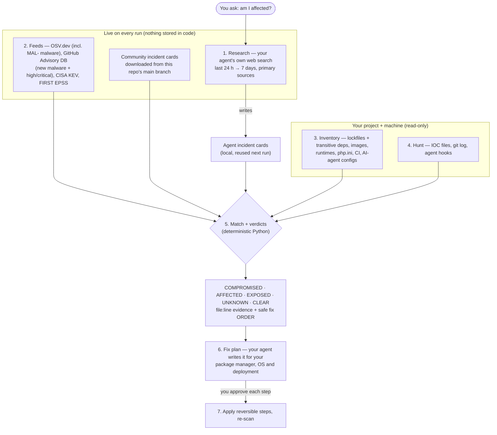

# zero-hour

> **Today's breach. Your stack. Am I hit, and what do I do right now?**

[](LICENSE)
[](https://agentskills.io)
[](package.json)
[](skills/zero-hour/scripts/)
[](SECURITY.md)

One skill for every AI coding agent. **The code contains no incident-specific logic.** On
every run:

1. Your agent uses its own web search to research what is happening *right now*.
2. zero-hour pulls live intel: new advisories, malicious packages and actively exploited CVEs.
3. zero-hour matches that intel against your project and your machine.
4. You get one verdict line per incident, with `file:line` evidence.
5. Your agent writes the fix for *your* setup, **in the order that is safe to run**.

**The standard advice for the Shai-Hulud worm ("rotate your GitHub token") wipes your home
directory.** Its `gh-token-monitor` runs `rm -rf ~/` when you revoke the stolen token.
zero-hour disarms first.

```bash
npx skills add akshitkhokhani/zero-hour
```

Then ask your agent: *"am I affected by the LiteLLM hack?"*

---

## Before / after

You ask your AI agent: *"Is my project hit by today's supply-chain attacks?"*

**Without zero-hour** (a typical answer):

```text
LiteLLM 1.107.0 was compromised. Check whether you use litellm and upgrade.
Also, rotate your GitHub token and npm token right now to be safe.
```

It does not check your lockfiles, misses transitive dependencies, ignores the payload
already on disk, and the "rotate now" step can trigger a dead-man switch.

**With zero-hour** (real output from launch day, 2026-10-22):

```text
ZERO-HOUR · my-app · 2026-10-22 14:59 UTC
intel: OSV ✓ · CISA KEV ✓ · EPSS ✓ · GitHub advisories ✓ · incident cards 8 (bundled, live-advisories)

🔴 COMPROMISED  LiteLLM 1.107.0 malicious release (PyPI + Docker) steals credentials via cook.pth
   evidence: .venv/lib/python3.12/site-packages/cook.pth contains "import cook"
   evidence: uv.lock:27 litellm 1.107.0  via crewai → litellm
🔴 AFFECTED     certifi bundles emSign root CAs with compromised intermediate CA keys
   evidence: uv.lock:5 certifi 2024.8.30  via crewai → litellm → httpx → certifi
🟢 CLEAR  tensorlake / Shai-Hulud worm · php2shell (CVE-2026-109618/109619)

SAFE ORDER — LiteLLM 1.107.0 …
1. Find every environment that has 1.107.0
2. Contain: stop the backdoor and quarantine the start-up files
   ⚠ Do this before rotating secrets, or the stealer grabs the new ones on the next Python start.
3. Rotate every secret the host could read, from a clean machine
…
→ Fix plan: your AI agent turns this into exact, verified steps for your setup.
```

The `certifi` line came from a GitHub advisory published the day before. No card, no
release, no code change: the live feed picked it up and the dependency graph showed it
three levels deep.

Verdicts:

- 🔴 **COMPROMISED**: zero-hour found indicators of compromise.
- 🔴 **AFFECTED**: a vulnerable or malicious version is present.
- 🟠 **EXPOSED**: the component is present, but a precondition is missing or unknown.
- 🟢 **CLEAR**: no affected version and no indicators.
- ⚪ **UNKNOWN**: zero-hour could not check it. It never guesses.

Fix plans always follow the same order: **contain / disarm → rotate → upgrade / pin → hunt
for spread → harden**.

## How it works



**What the code fixes:** only the *method*. That means the lockfile parsers, version matching, the IOC hunt and
the verdict rules. It also means the safe-order rule (contain → rotate → upgrade → hunt → harden) and the safety rules
(read-only, never print secrets).

**What is live:** every incident. Nobody needs to push code when a new attack happens:

- Your agent researches the last 24 hours to 7 days on each run.
- The feeds already list new malware and advisories within hours of publication.
- A community incident card merged into this repo reaches every user on their next run.
- The three cards in `skills/zero-hour/incidents/` are only seed examples from launch day. They are not the source of truth.

---

## Benchmarks

Measured on 10 popular open-source repos (33,716 locked packages in total: next.js, vscode, supabase, n8n,
WordPress, LiteLLM, LangChain, Home Assistant, Tauri, Laravel). Full table and method: [docs/BENCHMARKS.md](docs/BENCHMARKS.md).

- **Light:** peak memory **87 MB** or less, and repeat scans use **0.8 s CPU** or less. The process runs at low CPU priority.
- **Accurate:** compared with Google's osv-scanner on the same commits, zero-hour reports **2,286 of 2,287**
  lockfile-backed findings (1 missed). It adds incident context that a CVE scanner does not give.
- **Reproducible:** `python3 bench/run.py <dir-of-clones>` then `python3 bench/report.py`.

---

## Install

### Any agent (recommended)

```bash
npx skills add akshitkhokhani/zero-hour            # into the agents detected in this project
npx skills add akshitkhokhani/zero-hour -g         # global, for every project
npx skills add akshitkhokhani/zero-hour -a codex   # one specific agent
```

This uses the open [skills CLI](https://github.com/vercel-labs/skills), which copies the skill
into each agent's skills folder. `npx zerohour install [args]` runs the same command.

### Claude Code plugin

```text
/plugin marketplace add akshitkhokhani/zero-hour
/plugin install zero-hour@zero-hour
```

### Standalone CLI (no agent needed)

```bash
npx zerohour scan          # needs Node 18+ and Python 3.9+
```

### git clone

```bash
git clone https://github.com/akshitkhokhani/zero-hour ~/.claude/skills/zero-hour
```

| Agent | Skills folder |
|---|---|
| Claude Code | `~/.claude/skills/zero-hour` |
| Codex | `~/.codex/skills/zero-hour` \* |
| Cursor | `~/.cursor/skills/zero-hour` \* |
| Gemini CLI | `~/.gemini/skills/zero-hour` \* |
| GitHub Copilot | `~/.copilot/skills/zero-hour` \* |
| OpenCode | `~/.config/opencode/skills/zero-hour` \* |

\* These paths follow the Agent Skills convention. `npx skills add` uses the right path for
you. For agents that only read `AGENTS.md`, the repo root has an [`AGENTS.md`](AGENTS.md).

---

## Usage

### In your agent

Just ask. The skill activates from its description:

- *"Am I affected by the LiteLLM hack?"*
- *"Is the php2shell CVE a problem for this repo?"*
- *"Check this machine for the Shai-Hulud worm."*

Or call it directly:

```text
/zero-hour                 # today's incidents vs this project and machine
/zero-hour litellm         # one incident, package or CVE
/zero-hour --deep          # also CI, AI-agent configs, infra posture (read-only)
/zero-hour fix             # agent builds + applies the fix plan, one approved step at a time
```

### CLI

```bash
python3 skills/zero-hour/scripts/zerohour.py scan .                         # or: npx zerohour scan .
python3 skills/zero-hour/scripts/zerohour.py scan . --incident litellm      # one incident, package or CVE
python3 skills/zero-hour/scripts/zerohour.py scan . --deep --format json --out report.json
python3 skills/zero-hour/scripts/zerohour.py pulse --days 3                 # what is being exploited right now
python3 skills/zero-hour/scripts/zerohour.py inventory .                    # what zero-hour sees in your project
python3 skills/zero-hour/scripts/zerohour.py card template                  # start a new incident card
```

Exit codes: `0` nothing affected · `2` affected or compromised · `3` error.

### CI

```yaml
- name: zero-hour
  run: python3 skills/zero-hour/scripts/zerohour.py scan . --no-host --format sarif --out zero-hour.sarif
  # exits 2 when something is affected, which fails the job
```

Upload `zero-hour.sarif` with GitHub code scanning to see findings on the PR.

---

## What it checks

| Area | What zero-hour reads |
|---|---|
| Live intel | Your agent's own web research. OSV.dev (CVE/GHSA and `MAL-` malicious-package records). GitHub Advisory DB (malware + high/critical from the last N days). CISA KEV. FIRST EPSS. Incident cards (community cards downloaded live, and the cards your agent writes). |
| Dependencies | Lockfiles **including transitive deps**: npm, pnpm, yarn, bun, pip, uv, poetry, pipenv, composer, cargo, go, rubygems. Reports the path (`crewai → litellm 1.107.0`) |
| Runtimes | Dockerfile / compose base images, PHP / Python / Node versions, `php.ini` flags that change exposure |
| CI | GitHub Actions workflows |
| AI-agent configs | `.claude/settings.json` hooks, `.vscode/tasks.json`, `mcp.json` and similar files that worms plant |
| Host IOCs (read-only) | e.g. `cook.pth` in site-packages, `gh-token-monitor` LaunchAgent / systemd unit / scheduled task |

---

## Live incident cards

Feeds like OSV tell you *which versions* are bad. They do not tell you *what the payload
left on disk*, *which config makes you exposed*, or *which fix step is dangerous to run
first*. That lives in **incident cards**: small JSON files in [`incidents/`](skills/zero-hour/incidents/)
with affected packages, preconditions, IOCs and an ordered remediation list with danger
flags.

zero-hour downloads the latest cards from this repo on every run. A merged card reaches every
user on their next run, with no release and no reinstall. To skip the download, use
`--no-remote-cards` or `--offline`.

Your agent writes cards for whatever it researches (`zerohour.py card add`), and those are
used on every later scan. The three seed cards from launch day show what a good card looks
like:

- **LiteLLM 1.107.0** PyPI / Docker compromise (Oct 21, 2026): `cook.pth` credential stealer
- **php2shell** CVE-2026-109618 / CVE-2026-109619: PHP pre-auth RCE that depends on SAPI and `php.ini`
- **tensorlake 0.5.144** npm: Shai-Hulud worm with the `gh-token-monitor` dead-man switch

**Saw a new incident? Send a card.** This is the most useful contribution you can make.
See [CONTRIBUTING.md](CONTRIBUTING.md), or open an
[Incident card issue](https://github.com/akshitkhokhani/zero-hour/issues/new?template=incident-card.yml)
if you only have the facts and sources.

---

## Privacy & safety

- **Read-only by default.** zero-hour reads files and runs read-only commands. It changes
  nothing unless you approve a specific step.
- **Never prints secret values.** It reports *that* a credential exists and where, not the value.
- **No telemetry.** zero-hour sends nothing about you or your project to us.
- **What goes over the network:** zero-hour sends package names and versions to OSV.dev and
  CVE ids to FIRST EPSS. It downloads the CISA KEV catalog, recent GitHub advisories and the
  incident cards in this repo. Your agent's web research goes to the sites your agent picks. `--offline`
  turns all of this off.
- **No install scripts, no dependencies.** The npm package has no `preinstall` /
  `postinstall` hooks and no dependencies. The scripts are Python standard library only,
  so you can read every line that runs.
- The skills CLI (`npx skills`) has its own telemetry. Opt out with
  `DISABLE_TELEMETRY=1`.

---

## Scope

**Built for:** developers and small teams who see a breach in the news. In minutes, they
need to know if their project or laptop is hit, and what to do first.

**Not built for:**

- Not an EDR or antivirus. It checks indicators from live research and incident cards. It
  does not monitor your machine.
- Not a pentest or vulnerability scanner for your own code.
- Not a replacement for your vendor's advisory or your incident-response team. When the
  verdict is 🔴 COMPROMISED, treat it as a real incident.

---

## Contributing

Incident cards, parser fixes and new ecosystems are welcome. Read
[CONTRIBUTING.md](CONTRIBUTING.md). Security issues in zero-hour itself: see
[SECURITY.md](SECURITY.md). Please follow the [Code of Conduct](CODE_OF_CONDUCT.md).

---

## Sources

- [OSV.dev](https://osv.dev) and the [OpenSSF malicious-packages](https://github.com/ossf/malicious-packages) dataset
- [CISA Known Exploited Vulnerabilities catalog](https://www.cisa.gov/known-exploited-vulnerabilities-catalog)
- [FIRST EPSS](https://www.first.org/epss/)
- [Agent Skills specification](https://agentskills.io)
- [The Hacker News: LiteLLM compromised in supply-chain attack](https://thehackernews.com/2026/10/litellm-compromised-in-supply-chain.html)
- [Tenable: php2shell CVE-2026-109618 / CVE-2026-109619 FAQ](https://www.tenable.com/blog/php2shell-cve-2026-109618-cve-2026-109619-frequently-asked-questions-about-critical-php-remote)
- [StepSecurity: tensorlake npm compromised, hostage-token worm](https://www.stepsecurity.io/blog/tensorlake-npm-compromised-hostage-token-worm)

---

## License

[MIT](LICENSE) © 2026 Akshit Khokhani
